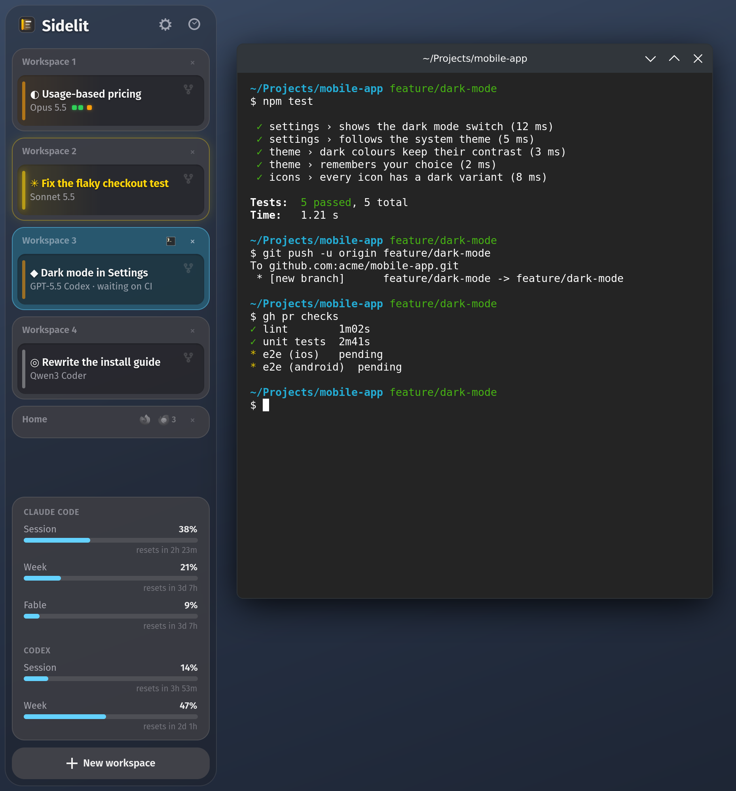
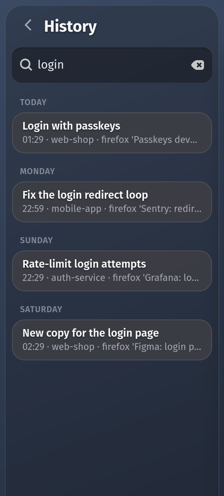
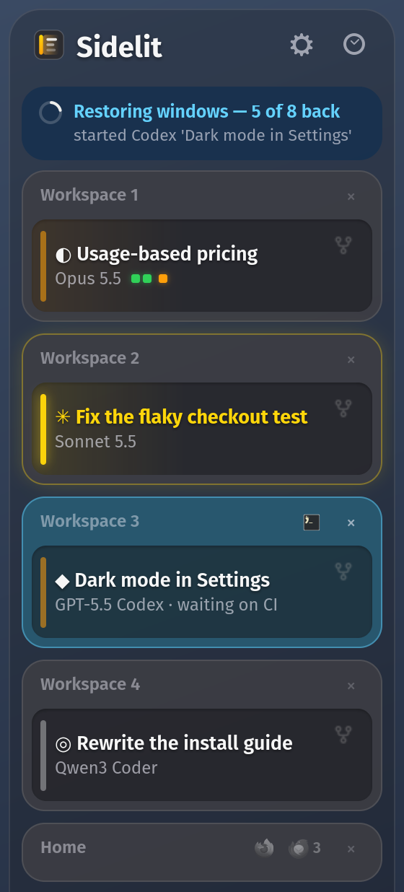
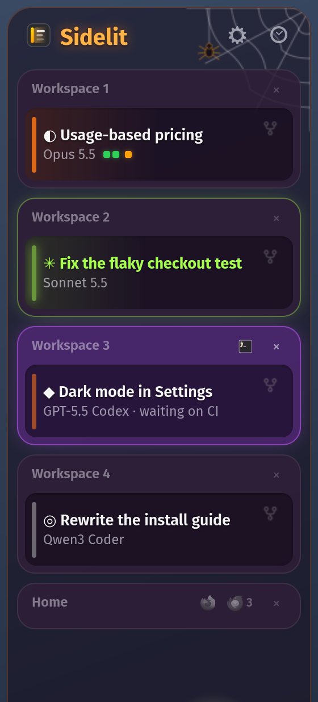
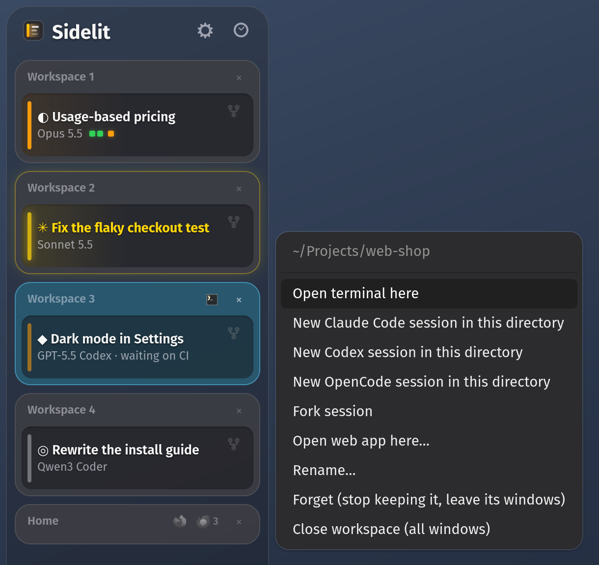

<p align="center">
  
</p>

<h1 align="center">Sidelit</h1>

<p align="center">
  <b>Your workspaces and coding agents, out of your head.</b><br>
  A sidebar for Linux that shows what every Claude Code, Codex and OpenCode session is doing,
  and puts every window back where it belongs.
</p>

<p align="center">
  <a href="https://github.com/kulaxa/sidelit/releases/latest"></a>
  <a href="https://github.com/kulaxa/sidelit/actions/workflows/ci.yml"></a>
  <a href="LICENSE"></a>
</p>

<p align="center">
  <a href="#install">Install</a> ·
  <a href="docs/guide.md">Guide</a> ·
  <a href="docs/desktops.md">Desktops</a> ·
  <a href="docs/agents.md">Coding agents</a> ·
  <a href="docs/config.md">Config</a>
</p>

<p align="center">
  
</p>

<p align="center"><i>Orange: working, or waiting on CI. Yellow: it needs you. Grey: done.</i></p>

## Why

Good work needs a clear head. With a few coding agents going at once, the head fills up with
bookkeeping instead: which workspace holds which project, which Claude finished half an hour ago
and is waiting for an answer, which one is only waiting on CI, where that Chrome tab went, which
shortcut takes you back.

Sidelit is built to take as much of that off you as it can, so your attention goes to the work
that matters. It sits at the left of your screen and keeps the map:

- **No agent forgotten.** Every workspace is a card, and every session on it says whether it is
  working, waiting for you or done. When one hands back to you, its card turns yellow. One that
  is only waiting for CI or a deploy says so and stays orange, so yellow always means your turn.
- **No workspace numbers to remember.** Every project is on screen by name. Click its card and
  you are there, with the keyboard in the session that has waited longest.
- **Nothing to set up again.** Each workspace keeps its windows. After a reboot, a crash or an
  unplugged screen, terminals come back in their folders, agent sessions come back resumed and
  Chrome windows come back with their tabs (through a small extension), each on its own
  workspace.
- **Nothing lost when you close it.** A closed workspace goes to a history you can search by
  title, folder or window. One click brings it back, windows and all.
- **Your limits in sight.** The 5-hour and weekly usage of Claude Code (on a Pro or Max plan)
  and Codex (logged in with ChatGPT) sit at the bottom.

## Install

```bash
curl -fsSL https://raw.githubusercontent.com/kulaxa/sidelit/main/get.sh | bash
```

Run it in a terminal on your desktop. It installs the few packages Sidelit needs (asking for
your password once), puts Sidelit in `~/.local/share/sidelit` and starts it; from then on it
starts at every login. Run the same line again to update, and
`~/.local/share/sidelit/uninstall.sh` to remove it. It knows Ubuntu, Linux Mint, Pop!_OS,
Debian, Fedora, Arch (with EndeavourOS, CachyOS and Manjaro) and openSUSE.

| Desktop | Session | Left to do after the install line |
|---|---|---|
| COSMIC (Pop!_OS 24.04 and later) | Wayland | nothing |
| KDE Plasma 6 | Wayland | nothing |
| GNOME 46 to 51 (Ubuntu, Debian, Fedora, Zorin) | Wayland | [log out and back in once](docs/install.md#on-gnome) |
| Hyprland | Wayland | [one line in its config](docs/install.md#on-hyprland), unless uwsm runs your session |
| niri | Wayland | nothing in niri's own session, else [one line in its config](docs/install.md#on-niri) |
| sway | Wayland | [one line in its config](docs/install.md#on-sway), unless your session runs autostart entries |
| Cinnamon (Linux Mint), Xfce, MATE | X11 | nothing |

The install line says what is left, if anything. The session features need `claude`, `codex`
or `opencode`; keeping windows in place works without them. For Chrome windows to come back tab
for tab, load [the companion extension](docs/install.md#chrome-windows-and-their-tabs). The
.deb, the Arch package and installing from a checkout are in [the install guide](docs/install.md).

## A closer look

<table>
  <tr>
    <td width="33%" valign="top"></td>
    <td width="33%" valign="top"></td>
    <td width="33%" valign="top"></td>
  </tr>
  <tr>
    <td valign="top"><b>Search what you closed.</b> The clock opens the workspaces you closed, by day. Pick one and it comes back with its windows.</td>
    <td valign="top"><b>Back after a login.</b> Sessions resumed, terminals in their folders, windows on their workspace, one at a time.</td>
    <td valign="top"><b>Themes.</b> Pick one in the settings, Halloween's among them, or write your own CSS.</td>
  </tr>
</table>

**Start anything from a card.** Right-click one for a new Claude Code, Codex or OpenCode session
in its folder, a fork of its session, a terminal, or a web app on that workspace.

<p align="center">
  
</p>

- **Waiting on CI is not waiting for you.** When a turn ends, a quick check reads how it ended
  and tells "needs you" from "waiting on a pipeline". It runs through the session's own agent,
  so there is nothing extra to set up. ([How](docs/guide.md#who-needs-you))
- **Click a session** to jump to its terminal, and to its pane in tmux, WezTerm or kitty.
- **Fork** a session into a new workspace with one click, like `/fork`.
- **Templates** for a new workspace: a session on its own, with a browser, with VS Code, or
  whatever you [write down](docs/config.md#templates).
- **Links open where you are.** `sidelit open URL` sends a link to the browser window on your
  workspace, not to whichever window the browser used last.
- **Why did that happen?** Every decision is journaled: `sidelit why Home` says what was kept,
  moved, forgotten or started on the workspace called Home, and why.
- **Other sources.** Agent jobs running elsewhere (a web app, a CI board, another machine) can
  show up in the sidebar too, from a small JSON feed ([how](docs/sources.md)).

The whole tour is in [the guide](docs/guide.md).

## Works with your agents

Sidelit plugs into Claude Code (✳), Codex (◆) and OpenCode (◎) as an ordinary plugin, installed
the way each agent installs plugins (for OpenCode, a file in its plugin folder). From then on,
sessions report what they are doing as it happens (Codex's once you trust its hooks). Sidelit
reads only what each agent offers for this and never touches your logins. Beyond its plugin it
changes nothing of theirs, except once: it takes out the hook an older Sidelit had put in Claude
Code's settings. The details, agent by agent, are in [Coding agents](docs/agents.md).

## Commands

```bash
sidelit                # start the daemon and the sidebar (it also starts at every login)
sidelit stop|restart|status|log
sidelit why TEXT       # why a window was kept, moved or forgotten
sidelit restore        # reopen what is missing, now
sidelit reapply        # put every window back on its workspace and screen
```

Every command is in [the guide](docs/guide.md#commands).

## Documentation

- [Install](docs/install.md): the packages, a checkout, the step left on GNOME, Hyprland, niri
  and sway, the GTK 4 sidebar, the Chrome extension, moving from Claude Workspace
- [Guide](docs/guide.md): everything the sidebar does, and every command
- [Desktops](docs/desktops.md): what works where, desktop by desktop
- [Coding agents](docs/agents.md): the Claude Code, Codex and OpenCode plugins, and what Sidelit
  reads
- [Config](docs/config.md): `config.json`, templates and themes
- [Other sources](docs/sources.md): sessions running elsewhere, in the sidebar
- [How it works](docs/how-it-works.md): the daemon, the engine, each desktop's backend,
  packaging and tests

## Licence

MIT, see [LICENSE](LICENSE). Copyright 2026 Mario Jalšovec.

Sidelit is an independent project, not made by or affiliated with Anthropic, OpenAI or
OpenCode's makers. Claude and Claude Code are trademarks of Anthropic; Codex is a trademark of
OpenAI.
